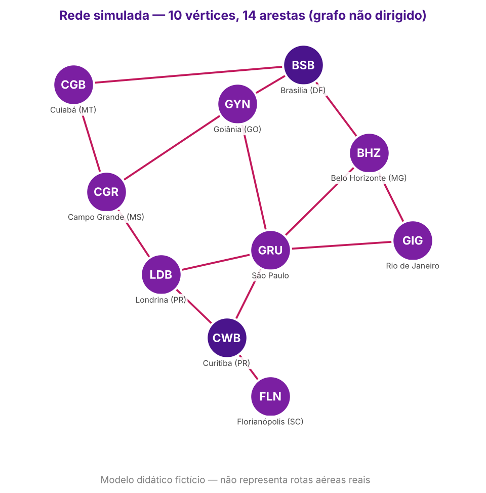
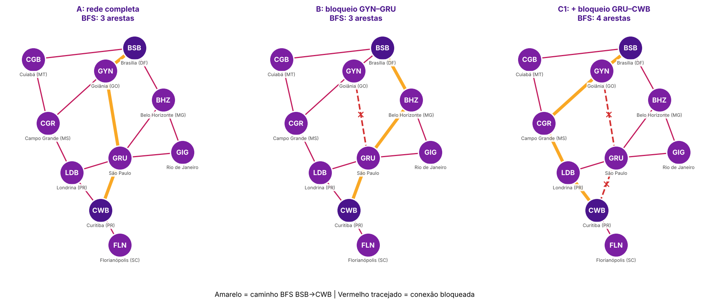

# Grafos, BFS e DFS — Conectividade em rede simulada

**Disciplina:** Estrutura de Dados II — Ciência da Computação
**Professora:** Kadidja Valéria
**Estudo de caso:** pane relacionada ao GPS e impactos em voos no Aeroporto de Brasília (G1, 22 set. 2026)

> **Aviso:** simulação computacional didática. Vértices, arestas e bloqueios são fictícios e **não** representam rotas aéreas reais nem podem orientar voos.

---

## 1. Problema e objetivo

Uma indisponibilidade de recursos de navegação pode exigir replanejamento operacional. Este trabalho modela uma rede **hipotética** de conexões entre cidades como um grafo e estuda, com BFS e DFS, se a rede continua conectada quando conexões ficam indisponíveis.

**Pergunta de pesquisa:**
> Se uma ou mais conexões da rede simulada ficarem indisponíveis, ainda existe caminho entre origem e destino? Quantas conexões a mais esse caminho exige, e como BFS e DFS se comportam diante do bloqueio?

**Objetivos:** modelar vértices e arestas; construir a lista de adjacência; implementar BFS e DFS; simular bloqueios sem alterar a rede original; comparar os caminhos e discutir limitações.

## 2. Como executar

Requisito: Python 3.8+ (somente biblioteca padrão; `matplotlib` apenas para os diagramas, já instalado no Colab).

### No Google Colab (recomendado)

**Opção 1 — notebook:** em [colab.research.google.com](https://colab.research.google.com) use *Arquivo → Fazer upload de notebook*, envie `solucao_grafos.ipynb` e clique em *Ambiente de execução → Executar tudo*. As células mostram, em ordem: o código, os diagramas, os experimentos, os testes e a busca interativa (que pede as respostas numa caixa abaixo da célula).

**Opção 2 — arquivo .py:** cole todo o conteúdo de `solucao_grafos.py` em uma célula e execute. Aparece um menu:

```
1 - Executar experimentos A, B, C e D
2 - Executar testes automáticos
3 - Buscar caminho (origem, destino e bloqueios)
0 - Sair
```

Também é possível enviar o arquivo pelo painel de arquivos do Colab e rodar `!python solucao_grafos.py --testes` ou `!python solucao_grafos.py --experimentos`.

### No terminal

```bash
python solucao_grafos.py                 # menu
python solucao_grafos.py --experimentos  # experimentos A, B, C e D
python solucao_grafos.py --testes        # 14 testes automáticos
```

Na busca, origem e destino podem ser digitados pela sigla (`BSB`, `gru`) ou pelo nome da cidade sem acento (`sao paulo`); entradas inexistentes são rejeitadas e o programa pede de novo. Bloqueios são informados como `GYN - GRU` e linha em branco encerra.

## 3. Estrutura do grafo

- **Tipo:** não dirigido (cada ligação vale nos dois sentidos) e não ponderado (todas as arestas “custam” 1).
- **Vértices (10):** aeroportos identificados pelas siglas IATA, as mesmas usadas no material da aula:

| Sigla | Cidade (UF) | Sigla | Cidade (UF) |
|---|---|---|---|
| BSB | Brasília (DF) | GIG | Rio de Janeiro/Galeão (RJ) |
| GYN | Goiânia (GO) | CGR | Campo Grande (MS) |
| BHZ | Belo Horizonte (MG)* | LDB | Londrina (PR) |
| CGB | Cuiabá (MT) | CWB | Curitiba (PR) |
| GRU | São Paulo/Guarulhos (SP) | FLN | Florianópolis (SC) |

\* BHZ é o código IATA da região metropolitana de Belo Horizonte, usado nos slides; o aeroporto de Confins tem o código CNF.

- **Arestas (14).**
- **Representação:** lista de adjacência (`dict` → `list`), gerada a partir de uma lista de pares por `construir_grafo()`, o que garante que cada aresta apareça nos dois extremos.



### Justificativa das conexões

| Escolha | Motivo no modelo |
|---|---|
| BSB com 3 saídas (GYN, BHZ, CGB) | Origem do estudo de caso; três “eixos” independentes permitem testar alternativas |
| GRU como vértice de maior grau (5) | Funciona como *hub*; bloqueá-lo mostra o quanto a rede depende dele |
| Corredor CGB – CGR – LDB | Rota pelo interior que **não passa por GRU**, tornando a rede robusta a falhas no *hub* |
| FLN ligada só a CWB | Aresta-**ponte** proposital, para demonstrar um caso de desconexão |

### Lista de adjacência

```
BSB        -> GYN, BHZ, CGB
GYN         -> BSB, GRU, CGR
BHZ  -> BSB, GIG, GRU
CGB          -> BSB, CGR
GRU       -> GYN, BHZ, GIG, CWB, LDB
CGR    -> GYN, CGB, LDB
GIG  -> BHZ, GRU
CWB        -> GRU, LDB, FLN
LDB        -> GRU, CGR, CWB
FLN   -> CWB
```

## 4. Implementação

| Função | O que faz |
|---|---|
| `construir_grafo(conexoes)` | Monta a lista de adjacência simétrica |
| `bfs(rede, origem, destino)` | Busca em largura com **fila FIFO** (`deque.popleft`). Marca o vértice como visitado ao enfileirar. Retorna `(caminho, ordem_de_visita)` |
| `dfs(rede, origem, destino)` | Busca em profundidade com **pilha LIFO** (`list.pop`). Usa `reversed` para explorar os vizinhos na ordem da lista |
| `bloquear_conexoes(rede, bloqueios)` | Devolve uma **cópia** sem as arestas, nos dois sentidos; erro se a aresta não existir |
| `resolver_nome(rede, texto)` | Valida a sigla ou o nome da cidade digitado, ignorando acentos e caixa |
| `numero_arestas(caminho)` | `len(caminho) - 1`, ou `None` se não houver caminho |

Complexidade de BFS e DFS com lista de adjacência: **O(V + E)**.
Quando não existe caminho, os dois algoritmos retornam `None` e o programa exibe “nenhum caminho encontrado”.

## 5. Resultados dos experimentos (BSB → CWB)



| Experimento | Bloqueio | BFS | Arestas | DFS | Arestas |
|---|---|---|:-:|---|:-:|
| **A** | nenhum | BSB → GYN → GRU → CWB | 3 | BSB → GYN → GRU → CWB | 3 |
| **B** | GYN–GRU | BSB → BHZ → GRU → CWB | 3 | BSB → GYN → CGR → LDB → GRU → CWB | **5** |
| **C1** | GYN–GRU + GRU–CWB | BSB → GYN → CGR → LDB → CWB | 4 | BSB → GYN → CGR → LDB → CWB | 4 |
| **C2** | GRU–CWB + LDB–CWB (destino FLN) | nenhum caminho | — | nenhum caminho | — |
| **D** | nenhum, mas vizinhos de BSB reordenados para `[CGB, BHZ, GYN]` | BSB → BHZ → GRU → CWB | 3 | BSB → CGB → CGR → GYN → GRU → CWB | **5** |

### Interpretação

- **A — rede completa:** os dois algoritmos coincidem por acaso: o primeiro ramo que o DFS aprofunda (via GYN) já leva a CWB pelo menor caminho.
- **B — um bloqueio:** a rede continua conectada e o **menor** caminho continua com 3 arestas (desvio por BHZ). O DFS, porém, mergulha no primeiro vizinho de GYN ainda disponível (CGR) e devolve um caminho de 5 arestas — válido, mas mais longo. É a diferença central entre os dois algoritmos.
- **C1 — dois bloqueios:** ainda há caminho porque o corredor do interior (CGR – LDB) liga a região de BSB a CWB **sem passar por GRU**. O custo sobe de 3 para 4 arestas (+1).
- **C2 — corte:** removendo GRU–CWB e LDB–CWB, CWB só fica ligada a FLN. As duas arestas formam um **conjunto de corte**: separam {CWB, FLN} do resto do grafo, que passa a ter duas componentes conexas. BFS e DFS esgotam a componente de BSB (8 vértices visitados) e retornam `None`.
- **D — ordem dos vizinhos:** o grafo é o mesmo, mas o DFS segue o primeiro vizinho da lista (CGB) até o fim do ramo e encontra outro caminho, de 5 arestas. O BFS pode até trocar o caminho (houve empate entre dois caminhos de 3 arestas), mas o **tamanho** continua mínimo.

Após todos os experimentos, a rede original foi verificada como **inalterada**.

## 6. Testes executados

Saída de `python solucao_grafos.py --testes` (completa em `evidencia_testes.txt`):

```
[OK ] Rede tem pelo menos 7 vértices
[OK ] Grafo é simétrico (não dirigido)
[OK ] BFS retorna o menor nº de arestas nos 90 pares
[OK ] DFS retorna caminho válido nos 90 pares
[OK ] Origem igual ao destino → caminho de 0 arestas
[OK ] Bloqueio não altera a rede original
[OK ] Bloqueio remove a aresta nos dois sentidos
[OK ] Após bloqueio ainda há caminho BSB→CWB
[OK ] Corte de CWB → BFS e DFS retornam None para FLN
[OK ] Bloqueio de aresta inexistente gera erro
[OK ] Sigla em minúsculas é reconhecida ('gru')
[OK ] Nome da cidade sem acento é reconhecido ('sao paulo')
[OK ] Sigla inexistente é rejeitada ('MAO')
[OK ] Mudar a ordem dos vizinhos muda o DFS, mas não o tamanho do BFS

14/14 testes aprovados.
```

O teste de otimalidade do BFS compara, para **todos os 90 pares** origem/destino, o resultado do BFS com uma busca por força bruta de todos os caminhos simples.

Evidências anexas:
- `evidencia_experimentos.txt` — saída completa dos experimentos A–D, com a ordem de visita de cada algoritmo.
- `evidencia_testes.txt` — saída dos testes automáticos.
- `evidencia_interativo.txt` — sessão pelo menu: sigla inexistente (`MAO`) rejeitada, sigla minúscula (`bsb`) e nome de cidade (`Curitiba`) aceitos, dois bloqueios e impacto de **+1 aresta**.

## 7. Comparação BFS × DFS

| | BFS | DFS |
|---|---|---|
| Estrutura | Fila (FIFO) | Pilha (LIFO) ou recursão |
| Estratégia | Explora por níveis (distância em arestas) | Aprofunda um ramo antes de voltar |
| Caminho encontrado | Menor nº de arestas (grafo não ponderado) | Um caminho qualquer, se existir |
| Depende da ordem dos vizinhos? | Só em empates; o tamanho é sempre mínimo | Sim, o caminho pode mudar muito (Exp. D) |
| Complexidade | O(V + E) | O(V + E) |
| Memória | Pode guardar um nível inteiro na fila | Proporcional à profundidade do ramo |
| Uso nesta solução | Medir o impacto do bloqueio (nº mínimo de conexões) | Verificar rapidamente se ainda existe conexão |

Para a pergunta “ainda existe caminho?”, **os dois respondem corretamente**: conectividade não depende da ordem de exploração. Para “quantas conexões a mais?”, **só o BFS** é confiável.

## 8. Limitações

- **Sem pesos:** “menor caminho” significa menos arestas, não menor distância, tempo, custo ou combustível. Para isso seria preciso um grafo ponderado e algoritmos como Dijkstra (Gomes, 2022, cap. 7).
- **Grafo não dirigido:** na realidade uma ligação pode existir em um só sentido ou em horários diferentes.
- **Bloqueios binários:** a aresta existe ou não; atrasos, capacidade reduzida e restrições parciais não são modelados.
- **Rede fictícia e pequena:** 10 vértices e 14 arestas, sem relação com malhas aéreas reais, regras de tráfego, meteorologia, combustível ou procedimentos de navegação.
- **Um caminho por busca:** os algoritmos retornam só um caminho; não listam todas as alternativas nem os caminhos de mesmo tamanho.
- **O bloqueio é hipótese didática**, não consequência comprovada da pane noticiada.

## 9. Questões para reflexão

**1. Por que um grafo representa melhor a rede do que uma árvore binária?**
Uma árvore binária tem hierarquia (raiz, pais e filhos), no máximo dois filhos por nó e exatamente um caminho entre dois nós. A rede tem ciclos (ex.: BSB – GYN – GRU – BHZ – BSB), vértices com 5 vizinhos e vários caminhos entre o mesmo par. São justamente os caminhos alternativos que permitem contornar um bloqueio, e uma árvore não os comporta.

**2. Em qual condição BFS encontra o menor caminho? O que significa “menor”?**
Quando o grafo é **não ponderado** (ou todas as arestas têm o mesmo peso). “Menor” significa **menor número de arestas**, não menor distância ou tempo. Isso vale porque o BFS visita os vértices em ordem crescente de distância em arestas: o primeiro momento em que o destino sai da fila é pelo nível mais baixo possível.

**3. Por que DFS pode retornar um caminho diferente de BFS?**
Porque o DFS segue o primeiro ramo disponível até o fim e retorna o primeiro caminho que alcança o destino, sem comparar com outros. No Experimento B ele entrou por CGR e achou um caminho de 5 arestas, enquanto existia um de 3. A ordem dos vizinhos determina qual ramo é explorado primeiro (Experimento D).

**4. O que ocorre sem um conjunto de visitados?**
Em um grafo com ciclos, os algoritmos voltariam a vértices já processados indefinidamente. Exemplo: BSB → GYN → BSB → GYN… O DFS entraria em laço infinito e o BFS encheria a fila com repetições, consumindo memória exponencialmente sem terminar quando não há caminho.

**5. Que informações seriam necessárias para avaliar tempo ou custo?**
Pesos nas arestas (distância, tempo de voo, custo, consumo), sentido das conexões, horários e frequências, capacidade, tempo de conexão nos vértices, condições meteorológicas e restrições operacionais. Com pesos, usar-se-ia Dijkstra ou A* em vez de BFS.

**6. Por que o resultado não pode orientar um voo real?**
O modelo é fictício e simplificado: ignora espaço aéreo, procedimentos de navegação, autorizações de controle de tráfego, meteorologia, combustível, desempenho da aeronave e redundâncias reais de navegação. Ele estuda **conectividade** em uma estrutura de dados, não navegação aeronáutica.

## 10. Conclusão

A rede simulada mostrou-se **robusta a um bloqueio**: removendo GYN–GRU, o menor caminho BSB → CWB continua com 3 arestas. Com dois bloqueios no eixo de GRU, ainda há caminho graças ao corredor do interior, com custo de +1 aresta. Já a remoção de duas arestas específicas (um conjunto de corte) desconecta CWB e FLN do restante da rede, e ambos os algoritmos detectam corretamente a ausência de caminho.

BFS é a escolha adequada para medir o impacto de um bloqueio em número de conexões; DFS serve para verificar conectividade, mas seu caminho depende da ordem dos vizinhos e não é necessariamente o mais curto.

## 11. Arquivos

| Arquivo | Conteúdo |
|---|---|
| `solucao_grafos.py` | Código-fonte (modelagem, BFS, DFS, bloqueios, experimentos, testes, menu) |
| `solucao_grafos.ipynb` | Mesmo código em notebook, pronto para o Google Colab |
| `README.md` | Este documento |
| `diagrama_grafo.png` | Diagrama da rede simulada |
| `cenarios_bloqueio.png` | Caminhos BFS nos cenários A, B e C1 |
| `evidencia_*.txt` | Saídas reais das execuções |

## 12. Referências

GOMES, Paulo César Rodacki. **Grafos: conceitos fundamentais, algoritmos e aplicações**. Blumenau: Editora IFC, 2022. ISBN 978-65-88089-12-5. (Capítulos 1, 2 e 3; capítulo 7 para aprofundamento.)

G1 DISTRITO FEDERAL. **Pane em GPS afeta voos da Azul no Aeroporto de Brasília; passageiros reclamam de atrasos**. 22 set. 2026. Disponível em: https://g1.globo.com/df/distrito-federal/noticia/2026/09/22/pane-em-gps-afeta-voos-da-azul-no-aeroporto-de-brasilia-passageiros-reclamam-de-atrasos.ghtml.
